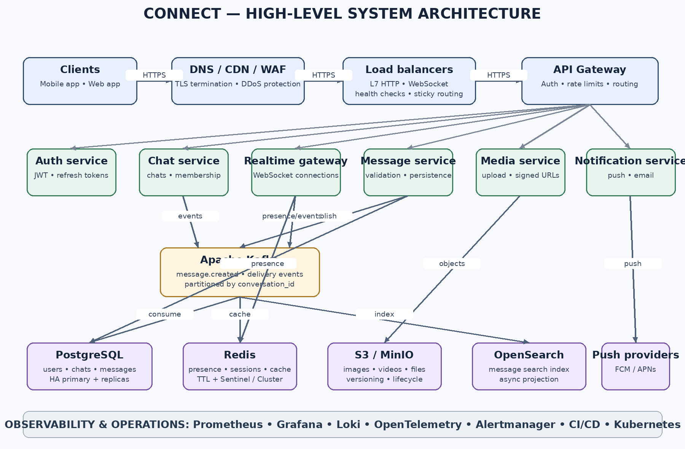

# Connect — масштабируемый мессенджер

> Учебный архитектурный проект. Документ описывает целевую архитектуру сервиса обмена личными и групповыми сообщениями в реальном времени, расчётную нагрузку, выбор технологий, ёмкостное планирование и подходы к надёжности.

## 1. Описание продукта

**Connect** — кроссплатформенный мессенджер для личного и группового общения. Пользователь может отправлять текстовые сообщения, изображения и файлы, видеть статусы доставки и прочтения, получать push-уведомления и синхронизировать историю между устройствами.

### 1.1. Проблема и целевая аудитория

Сервис решает задачу быстрого и надёжного обмена сообщениями с доступом с нескольких устройств. Целевая аудитория: частные пользователи, небольшие сообщества, учебные и рабочие группы. В первой версии продукт не позиционируется как корпоративная система с юридически значимым архивом или как платформа с гарантированной сквозной E2E-шифрацией.

### 1.2. Аналоги и позиционирование

Рыночные аналоги: Telegram, WhatsApp и Signal. Их официальные материалы описывают востребованные сценарии: личные и групповые переписки, обмен файлами и медиа, синхронизацию между устройствами, управление группами и защиту приватности. Например, Telegram указывает на синхронизацию сообщений между несколькими устройствами и поддержку групп; WhatsApp описывает групповые чаты, события, опросы и отправку файлов; Signal делает акцент на сквозном шифровании и групповых переписках. Это подтверждает наличие сформированного пользовательского сценария, но не доказывает размер рынка Connect. Поэтому MAU ниже является расчётной целью учебного проекта, а не прогнозом доли рынка.

| Аналог | Подтверждённые сценарии из официальных материалов | Архитектурный вывод для Connect |
|---|---|---|
| Telegram | Облачные чаты, синхронизация между устройствами, группы, поиск, файлы | Нужны серверная история, multi-device sync, поиск и масштабируемая доставка |
| WhatsApp | Личные и групповые сообщения, опросы, события, файлы и медиа | Нужны групповые чаты, медиа-хранилище и расширяемая модель событий |
| Signal | Группы, вложения и E2E-шифрование по умолчанию | Приватность должна быть отдельным архитектурным требованием; E2EE нельзя заявлять без отдельного проектирования ключей и multi-device |

Официальные материалы аналогов приведены в разделе источников. Connect рассматривается как учебный проект, поэтому его отличие — прозрачная демонстрация масштабируемой архитектуры, а не конкуренция с перечисленными продуктами по набору функций.

### 1.3. Оценка аудитории (bottom-up)

Для учебного планирования принимается целевой охват **1 000 000 MAU** после выхода на зрелую стадию. Это сценарное допущение, а не результат маркетингового исследования.

| Параметр | Значение | Обоснование |
|---|---:|---|
| Потенциально доступная аудитория | 5 000 000 | Условный TAM выбранного сегмента |
| Доля привлечённых пользователей | 20% | Сценарий проникновения |
| MAU | 1 000 000 | 5 000 000 × 20% |
| DAU / MAU | 20% | Допущение для коммуникационного продукта |
| DAU | 200 000 | 1 000 000 × 20% |
| Среднее число активных часов в день | 4 ч | Допущение для оценки concurrency |
| Пиковый коэффициент относительно среднего | 1,5 | Суточная неравномерность |
| Одновременные соединения в пик | 50 000 | Расчётная целевая нагрузка |

Проверка одновременных соединений: `200 000 DAU × 4 часа / 24 часа × 1,5 пиковый коэффициент = 50 000`. В этой модели среднее число одновременно активных пользователей составляет около 33 300, а пик — около 50 000. Значение округлено вверх; фактическое число должно уточняться нагрузочным тестом и продуктовой аналитикой.

### 1.4. Ключевые пользовательские сценарии

1. Регистрация, вход и обновление токенов.
2. Создание личного чата и группы.
3. Отправка и получение сообщения в реальном времени.
4. Доставка сообщения офлайн-пользователю после повторного подключения.
5. Отправка вложения через объектное хранилище.
6. Получение статусов `sent`, `delivered`, `read`.
7. Поиск по истории переписки.
8. Push-уведомление при отсутствии активного соединения.

### 1.5. Продуктовые метрики

| Метрика | Целевое значение | Как измеряется |
|---|---:|---|
| MAU | 1 000 000 | Уникальные пользователи за 30 дней |
| DAU | 200 000 | Уникальные пользователи за сутки |
| DAU/MAU | ≥ 20% | DAU / MAU |
| D7 retention | ≥ 35% | Доля вернувшихся на 7-й день |
| Сообщений на DAU в день | 100 | Счётчик принятых пользовательских сообщений |
| Доля успешной отправки | ≥ 99,9% | Успешные подтверждения / попытки |
| Время до первого сообщения | ≤ 2 мин | От регистрации до первого отправленного сообщения |

### 1.6. Технические SLI/SLO

| SLI | SLO | Окно |
|---|---:|---|
| Доступность API отправки | 99,95% | 30 дней |
| Успешное принятие валидного сообщения | ≥ 99,9% | 30 дней |
| API latency, p95 | ≤ 200 мс | 30 дней |
| API latency, p99 | ≤ 500 мс | 30 дней |
| Доставка онлайн-получателю, p95 | ≤ 1 с | 30 дней |
| Восстановление после отказа узла приложения | ≤ 2 мин | Учебный целевой показатель |
| RPO для подтверждённых сообщений | 0 при потере одного узла/зоны с синхронной standby; ≤ 5 мин при потере всего региона с асинхронной межрегиональной репликацией | Зависит от сценария |
| RTO при потере региона | ≤ 60 мин | Учебный целевой показатель |

SLO — проектные цели, а не обещание фактического уровня сервиса. Для подтверждённых сообщений API возвращает успех только после надёжной записи в PostgreSQL (и фиксации события в transactional outbox).

## 2. Расчёт нагрузки и ёмкостное планирование

### 2.1. Сообщения и RPS

Принимаются следующие допущения:

- 200 000 DAU;
- 100 сообщений на одного DAU в сутки;
- 20 млн сообщений в сутки;
- средний размер текстового тела — 1 КБ;
- коэффициент пиковой нагрузки — 8 относительно среднего RPS.

Средний входящий поток:

`20 000 000 / 86 400 ≈ 231 сообщений/с`.

Пиковый поток:

`231 × 8 ≈ 1 850 сообщений/с`.

Для запаса проектируем систему на **2 500 сообщений/с**. При fan-out на несколько устройств/участников исходящий поток WebSocket-событий может быть выше числа входящих сообщений. Для расчёта закладываем средний fan-out 2,5: до 6 250 исходящих доставок/с в пик.

### 2.2. Объём хранения

| Данные | Допущение | Объём |
|---|---|---:|
| Текст сообщений | 20 млн × 1 КБ/сутки | ~20 ГБ/сутки |
| Сообщения за 30 дней | 20 ГБ × 30 | ~600 ГБ |
| Индексы и служебные поля | 35% от данных | ~210 ГБ / 30 дней |
| PostgreSQL за 30 дней | Данные + индексы | ~810 ГБ |
| Вложения | 5% сообщений × 2 МБ | ~2 ТБ/сутки |
| Вложения за 30 дней | 2 ТБ × 30 | ~60 ТБ |
| События Kafka | 20 млн × 1 КБ × 3 дня | ~60 ГБ логических данных |
| Kafka с RF=3 | 60 ГБ × 3 | ~180 ГБ до запаса |

Вложения — самый быстрорастущий тип данных. Для объектного хранилища принимается срок горячего хранения 90 дней: около 180 ТБ без учёта репликации и резервных копий. Далее объекты могут переводиться в более дешёвый storage tier или удаляться по политике хранения. Политика должна учитывать пользовательские настройки, требования законодательства и удаление аккаунта.

Оценки не включают полную стоимость WAL, временных файлов, резервных копий, реплик, компрессии и рост индексов. Для production-планирования нужен запас 30–50% и проверка реальными профилями данных.

Формулы для воспроизводимости расчёта:

- `Объём сообщений в сутки = число сообщений × средний размер записи`.
- `Объём за период = суточный объём × число дней хранения`.
- `Объём вложений = сообщений в сутки × доля сообщений с вложением × средний размер вложения`.
- `Пиковый RPS = средний RPS × коэффициент пика`.
- `Число исходящих доставок/с = входящий messages/s × средний fan-out`.

В расчёте не смешиваются логический объём данных и физическая ёмкость: RF=3 в Kafka увеличивает физическую потребность примерно втрое; реплики PostgreSQL также требуют дополнительного дискового пространства. Для S3 при erasure coding/репликации коэффициент хранения определяется конфигурацией конкретного провайдера. Резерв 30–50% добавляется после учёта репликации, индексов, WAL и временных файлов, а не вместо них.

### 2.3. Оценка серверных ресурсов

Предварительная стартовая конфигурация для целевой нагрузки; окончательные размеры выбираются нагрузочным тестированием.

| Компонент | Количество | Ресурсы одного узла | Суммарно |
|---|---:|---|---|
| Kubernetes worker для stateless API | 6 | 8 vCPU, 32 ГБ RAM | 48 vCPU, 192 ГБ |
| Realtime/WebSocket workers | 6 | 8 vCPU, 32 ГБ RAM | 48 vCPU, 192 ГБ |
| PostgreSQL primary + 2 replicas | 3 | 16 vCPU, 64 ГБ RAM, NVMe 2 ТБ | 48 vCPU, 192 ГБ, 6 ТБ |
| Redis Cluster (3 primary + 3 replica) | 6 | 8 vCPU, 32 ГБ RAM | 48 vCPU, 192 ГБ |
| Kafka brokers | 3 | 8 vCPU, 32 ГБ RAM, NVMe 2 ТБ | 24 vCPU, 96 ГБ, 6 ТБ |
| OpenSearch data nodes | 3 | 8 vCPU, 32 ГБ RAM, NVMe 2 ТБ | 24 vCPU, 96 ГБ, 6 ТБ |
| Observability | 2 | 8 vCPU, 32 ГБ RAM | 16 vCPU, 64 ГБ |
| **Итого** | **29** | — | **256 vCPU, 1 024 ГБ RAM** |

Это не минимальная конфигурация для MVP, а ориентир для учебного сценария с резервом и разнесением stateful-компонентов. Объектное хранилище предполагается как управляемый S3-сервис; при самостоятельном MinIO потребуется отдельный кластер с дисками, рассчитанный на выбранный уровень erasure coding и отказоустойчивости. В production также нужны отдельные узлы/пулы для системных компонентов Kubernetes и резерв мощности на rolling update.

#### Обоснование типов ресурсов

- **CPU для stateless-сервисов** нужен для обработки сетевых соединений, сериализации, проверки прав, маршрутизации и fan-out. Realtime Gateway выделен в отдельный пул, поскольку долгоживущие соединения создают иной профиль нагрузки, чем короткие HTTP-запросы.
- **RAM для WebSocket-узлов** расходуется на состояние соединений, буферы, TLS и очереди отправки. Важнее контролировать память на одно соединение и ограничивать размер outbound queue, чем просто увеличивать лимит подключений.
- **NVMe для PostgreSQL** выбран из-за случайных операций чтения/записи, WAL и требований к низкой задержке транзакций. Размер диска 2 ТБ на узел — стартовая оценка, а не гарантия достаточности; фактическая ёмкость зависит от retention, индексов, WAL и запаса для vacuum/maintenance.
- **NVMe для Kafka** нужен для последовательной записи сегментов журнала и чтения consumer-групп. Три брокера дают репликацию RF=3, но полезная ёмкость меньше суммарной сырой ёмкости из-за репликации и резерва свободного места.
- **RAM для Redis** зависит от числа активных сессий и ключей presence. Для оценки требуется замер среднего размера ключа с учётом overhead Redis и коэффициента fragmentation.
- **RAM и диск OpenSearch** зависят от объёма индексируемого текста, числа shard/replica и поисковой нагрузки. Heap JVM следует держать в рекомендованных пределах, а не отдавать всю память процессу.
- **Резерв мощности** нужен для отказа одного узла, rolling deployment и кратковременных пиков. Кластер не должен работать постоянно на 90–100% CPU или дисковой ёмкости.

## 3. Архитектура системы

### 3.1. Компоненты

| Компонент | Ответственность | Масштабирование |
|---|---|---|
| DNS/CDN/WAF | DNS, защита периметра, TLS, фильтрация атак | Управляемый сервис / несколько edge-точек |
| Load balancer | L7 маршрутизация HTTP и WebSocket | Несколько экземпляров в разных зонах |
| API Gateway | Аутентификация, rate limit, маршрутизация | Горизонтально |
| Auth service | Регистрация, вход, refresh token, управление сессиями | Горизонтально |
| Chat service | Чаты, участники, права доступа | Горизонтально |
| Realtime Gateway | Долгоживущие WebSocket-соединения, presence | Горизонтально, с учётом числа соединений на pod |
| Message service | Проверка, запись и публикация сообщений | Горизонтально |
| Media service | Выдача подписанных URL, метаданные вложений | Горизонтально |
| Notification service | Push через FCM/APNs, повторы и дедупликация | Горизонтально |
| Kafka | Асинхронные события и развязка сервисов | Партиции и брокеры |
| PostgreSQL | Источник истины для аккаунтов, чатов и сообщений | Реплики чтения, партиционирование |
| Redis | Presence, короткоживущий кэш, rate limit | Redis Cluster |
| S3/MinIO | Бинарные вложения | Ёмкость и пропускная способность storage |
| OpenSearch | Поисковый индекс сообщений | Индексные шарды и реплики |

### 3.2. Балансировка нагрузки

**Nginx или облачный L7 Load Balancer** используется для HTTP API и WebSocket upgrade. L7 выбран потому, что позволяет маршрутизировать запросы по host/path, завершать TLS, ограничивать размер тела запроса и проверять здоровье backend. Для внешнего трафика предпочтителен управляемый балансировщик в нескольких зонах доступности; Nginx остаётся вариантом для самостоятельного развёртывания и ingress.

**Алгоритмы:**

- `Least Connections` — предпочтителен для WebSocket: соединения долгоживущие, поэтому число активных соединений лучше отражает текущую нагрузку, чем число новых запросов.
- `Round Robin` — подходит для коротких stateless HTTP-запросов при близкой производительности узлов.
- `Weighted Least Connections` — позволяет учитывать разную мощность узлов и плавный ввод новых экземпляров.
- Health checks — исключают недоступные экземпляры из пула.
- Connection draining — даёт существующим WebSocket-соединениям время на корректное завершение при обновлении.
- Sticky sessions не используются как обязательная гарантия корректности: состояние сессии и presence вынесено в Redis, а соединение может восстановиться на другом узле.

На уровне Kubernetes применяется readiness/liveness probes и autoscaling по CPU, памяти и прикладным метрикам: активные соединения, очередь отправки и задержка обработки.

### 3.3. Хранение данных

| Система | Какие данные хранит | Почему выбрана | Ограничения и меры |
|---|---|---|---|
| PostgreSQL | Пользователи, чаты, участники, сообщения, outbox | ACID, транзакции, зрелая экосистема, индексы и JSONB | Нужны партиционирование, vacuum, контроль bloat и репликации |
| Redis | Presence, сессии, rate-limit counters, краткоживущий кэш | Низкая задержка, TTL, атомарные операции | Не источник истины; persistence и HA настраиваются отдельно |
| Kafka | События сообщений, доставки, уведомлений | Высокая пропускная способность, replay, consumer groups | Порядок только внутри partition; контроль lag и retention |
| S3/MinIO | Изображения, видео и файлы | Дешёвое масштабируемое объектное хранение | Версионирование, lifecycle, шифрование, checksum |
| OpenSearch | Поисковый индекс | Полнотекстовый поиск и фильтры | Индекс — производная копия, восстанавливается из источника/событий |

#### PostgreSQL

- Схема: `users`, `chats`, `chat_members`, `messages`, `message_receipts`, `outbox_events`.
- Для `messages` — range partitioning по времени или hash partitioning по `conversation_id`; конкретная стратегия выбирается по запросам и объёму.
- Индексы: `(conversation_id, created_at, message_id)` для истории; уникальный `(sender_id, client_message_id)` для идемпотентности.
- Один primary и две standby-реплики в разных зонах доступности. Для сценария RPO=0 при отказе одной зоны commit подтверждается после flush WAL на выделенной синхронной standby (`synchronous_commit=on`, `synchronous_standby_names`); вторая реплика может быть асинхронной для чтения/аварийного восстановления. Межрегиональная репликация обычно асинхронная, поэтому для потери всего региона допускается RPO до 5 минут. Переключение выполняется контролируемо, с fencing старого primary во избежание split-brain.
- PgBouncer ограничивает число соединений.
- Наблюдаемость: connections, transaction rate, locks, deadlocks, cache hit ratio, replication lag, WAL rate, disk IOPS, bloat, autovacuum.
- Надёжность: PITR, регулярные restore-тесты, проверка репликации, резервные копии в отдельном регионе/аккаунте.

#### Redis

- Кэш и presence имеют TTL; потеря этих данных не должна приводить к потере сообщений.
- Для целевой конфигурации выбран Redis Cluster из шести узлов: три master shard и три replica (по одной реплике на master), размещённые минимум в трёх зонах доступности. Это даёт горизонтальное распределение ключей и возможность пережить отказ одного узла; Sentinel — альтернативный вариант для primary/replica без шардирования.
- Настроить `maxmemory` и политику eviction отдельно для каждого набора ключей; критические ключи не должны неожиданно вытесняться.
- Наблюдать memory fragmentation, evictions, hit rate, latency, connected clients, replication health и failover.
- Redis не используется как единственное хранилище подтверждённых сообщений.

#### Kafka

- Топики разделяются по назначению: `message-events`, `delivery-events`, `notification-events`.
- Ключ партиционирования — `conversation_id`, чтобы сохранять порядок событий внутри чата.
- Replication factor 3, `min.insync.replicas=2`, producer `acks=all`; включить идемпотентного producer и контролировать ISR.
- Retention для исходных событий — 3 дня в расчётном сценарии; срок уточняется исходя из потребности replay и бюджета.
- Наблюдать consumer lag, under-replicated partitions, ISR shrink, request latency, disk usage, produce/fetch rate.
- При ошибках consumer использует retry с backoff, затем DLQ; повторная обработка безопасна за счёт идемпотентности.

#### S3 / MinIO

- Клиент получает pre-signed URL; бинарные данные загружаются напрямую в объектное хранилище, не через API-сервис.
- Метаданные объекта (owner, chat, size, MIME, checksum, lifecycle state) хранятся в PostgreSQL.
- Включить encryption at rest, TLS, bucket policy, антивирусную проверку и ограничение MIME/размера.
- Использовать lifecycle policy для перехода старых файлов в cold tier и удаления по сроку хранения.
- Наблюдать storage capacity, request rate, 4xx/5xx, latency, replication/erasure health и failed uploads.

#### OpenSearch

- Индекс строится асинхронно из Kafka; PostgreSQL остаётся источником истины.
- Использовать отдельные индексы/алиасы по периоду или tenant при необходимости.
- Включить replicas, snapshots и контроль heap pressure, shard size, indexing latency, search latency, rejected requests и disk watermark.
- При отставании индекса поиск может показывать данные с задержкой; интерфейс должен допускать eventual consistency.

### 3.4. Выбор языка и фреймворков

| Технология | Использование | Обоснование |
|---|---|---|
| Go | Realtime Gateway, Message service, Chat service | Эффективная конкурентность, низкие накладные расходы, простая сборка бинарных файлов |
| Go + gRPC | Внутренние RPC | Типизированные контракты, компактный протокол, генерация клиентов |
| REST/JSON | Публичный API | Совместимость с web/mobile-клиентами и простота интеграции |
| WebSocket | Двусторонний realtime-канал | Постоянное соединение и доставка серверных событий клиенту |
| SQL migrations | Изменение схемы PostgreSQL | Версионируемые и повторяемые изменения БД |

Go выбран как основной язык, чтобы сократить число технологий в учебном проекте. Для production допустимо выделить отдельные сервисы на других языках только при доказанной необходимости.

## 4. Взаимодействие компонентов и обработка данных

### 4.1. Матрица взаимодействий

| Откуда → куда | Протокол/инструмент | Синхронность | Обоснование |
|---|---|---|---|
| Mobile/Web → Gateway | HTTPS REST | Синхронно | Команды, настройки, история |
| Mobile/Web ↔ Realtime Gateway | WebSocket | Двусторонне | Мгновенная доставка событий |
| Gateway → Auth/Chat/Message | gRPC | Синхронно | Типизированные внутренние контракты |
| Message service → PostgreSQL | SQL | Синхронно | Надёжная запись и транзакции |
| Message service → Kafka | Outbox relay | Асинхронно | Не терять событие между commit БД и publish |
| Kafka → Realtime Gateway | Kafka consumer | Асинхронно | Масштабируемый fan-out |
| Kafka → Notification service | Kafka consumer | Асинхронно | Push не задерживает отправку сообщения |
| Media service ↔ S3 | HTTPS API | Синхронно при upload | Передача больших файлов вне API |
| Kafka → OpenSearch indexer | Kafka consumer | Асинхронно | Поиск не блокирует отправку сообщения |

### 4.2. Сценарий отправки сообщения

1. Клиент отправляет `message.send` по WebSocket или HTTPS с `client_message_id`.
2. Gateway проверяет access token, лимиты и формат сообщения.
3. Message service проверяет членство отправителя в чате.
4. В одной транзакции PostgreSQL записывает сообщение и событие в `outbox_events`.
5. После commit клиент получает ACK с серверным `message_id`.
6. Outbox relay публикует событие в Kafka; после подтверждения помечает outbox-запись обработанной.
7. Realtime consumers доставляют событие подключённым получателям.
8. Notification service отправляет push тем адресатам, у которых нет активного соединения.
9. Отдельные события обновляют статусы доставки и прочтения.

**Важно:** ACK означает, что сообщение сохранено в основной БД, а не то, что оно уже прочитано получателем. Статусы имеют разный смысл: `accepted/sent`, `delivered`, `read`.

### 4.3. Гарантии доставки и идемпотентность

- Сеть и брокер могут доставить событие повторно. Поэтому базовая модель — **at-least-once**, а не обещание exactly-once end-to-end.
- Клиент генерирует `client_message_id`; уникальный индекс `(sender_id, client_message_id)` предотвращает дубли при повторном запросе.
- Consumer хранит обработанные event IDs или использует уникальные ключи в целевой таблице.
- Порядок сообщений в одном чате обеспечивается ключом Kafka `conversation_id` и монотонным серверным sequence number в пределах чата.
- Повторная отправка использует exponential backoff с jitter, например 0,5 с → 1 с → 2 с → 4 с, с ограничением числа попыток.
- После исчерпания попыток событие попадает в DLQ с причиной, event ID и correlation ID; предусмотрен контролируемый replay.
- Не следует бесконечно повторять ошибки валидации, авторизации и другие постоянные 4xx.

### 4.4. Транзакционность

Запись сообщения и outbox-события выполняется в одной транзакции PostgreSQL. Это устраняет dual-write проблему между БД и Kafka: событие либо сохранено в outbox вместе с сообщением, либо не сохранено вовсе. Публикация из outbox может повториться, поэтому потребители обязаны быть идемпотентными.

Для операций изменения состава группы проверка прав и изменение membership выполняются транзакционно. Для файлов используется state machine: `created → uploading → scanned → available` либо `rejected/expired`; незавершённые загрузки удаляются lifecycle job.

### 4.5. Таймауты и повторные попытки

| Операция | Таймаут/политика |
|---|---|
| Публичный REST API | 3–5 с на запрос; тяжёлые операции асинхронно |
| Внутренний gRPC | Deadline 1–2 с для обычных RPC |
| PostgreSQL statement timeout | 1–3 с для online-запросов; отдельные лимиты для фоновых задач |
| Redis | 50–100 мс для типовых операций |
| Kafka produce | Ограниченный delivery timeout, retries и `acks=all` |
| WebSocket heartbeat | Ping/pong каждые 20–30 с |
| Push provider | 3–5 с на попытку, ограниченный retry с backoff |

Точные значения должны корректироваться по latency budget и результатам нагрузочного тестирования. Повторять можно только операции, которые идемпотентны или имеют ключ идемпотентности.

### 4.6. Наблюдаемость взаимодействий

Каждый запрос получает `trace_id`/`correlation_id`, который передаётся через gRPC metadata и Kafka headers. Для синхронных вызовов измеряются latency, error rate, timeout rate и saturation. Для асинхронных — consumer lag, возраст старейшего события, количество retry, DLQ и время от создания события до доставки. В логах запрещено сохранять содержимое личных сообщений и access tokens.

## 5. Обработка данных и AI/ML

В первой версии Connect **не использует генеративный AI как критическую часть доставки сообщений**. Это сознательное решение: отправка и получение сообщений должны оставаться быстрыми, предсказуемыми и доступными даже при недоступности ML-компонентов.

### 5.1. Специализированная обработка

| Задача | Инструмент/подход | Обоснование |
|---|---|---|
| Поиск по сообщениям | OpenSearch | Полнотекстовый поиск и фильтрация |
| Антивирусная проверка вложений | ClamAV или managed malware scanning | Не допускать распространение вредоносных файлов |
| Модерация жалоб | Правила + очередь ручной проверки | Прозрачность решений и возможность апелляции |
| Аналитика продукта | События в аналитическое хранилище | Retention, воронки, активность |
| Определение спама | Правила rate limit; ML-классификатор как следующий этап | Сначала простые объяснимые меры |

### 5.2. Возможное применение ML

На следующем этапе можно добавить ML-классификатор спама/фишинга по текстовым и поведенческим признакам. Модель не должна автоматически блокировать пользователя без механизма апелляции и контроля ложноположительных срабатываний. Необходимо минимизировать персональные данные, определить срок хранения признаков и оценивать качество по precision, recall и false positive rate.

### 5.3. Оценка ресурсов ML

Для пилотного классификатора допускается CPU inference: 2–4 vCPU и 4–8 ГБ RAM на экземпляр, 2 экземпляра для отказоустойчивости. Если используется компактная модель и поток до 100 запросов/с, этого может быть достаточно, но это только предварительная оценка. Требуются benchmark на реальных обезличенных данных и измерение p95 latency. GPU на старте не закладывается. ML-сервис изолирован от критического пути отправки: при его отказе сообщение доставляется, а проверка может быть отложена или заменена правилами.

## 6. Надёжность, безопасность и эксплуатация

### 6.1. Требования к надёжности

- Stateless API и realtime pods масштабируются горизонтально.
- Stateful-системы размещаются минимум в трёх зонах доступности, если это поддерживает инфраструктура.
- Подтверждённое сообщение не зависит от Redis, OpenSearch или push-провайдера.
- Для деградации второстепенных функций предусмотрен graceful degradation: поиск и push могут временно отставать, отправка сообщений продолжает работать.
- Резервные копии и snapshots хранятся отдельно от основного кластера.

### 6.2. Мониторинг и точки сбора метрик

| Уровень | Метрики | Инструменты |
|---|---|---|
| API | RPS, p50/p95/p99, 4xx/5xx, saturation | Prometheus, Grafana |
| WebSocket | Active connections, reconnects, disconnect reason, outbound queue | Prometheus |
| PostgreSQL | Replication lag, locks, connections, WAL, disk, query latency | postgres_exporter |
| Redis | Memory, evictions, hit ratio, failover, latency | redis_exporter |
| Kafka | Consumer lag, ISR, under-replicated partitions, throughput | Kafka exporter |
| S3/MinIO | Capacity, errors, request latency, failed uploads | Storage metrics |
| OpenSearch | Heap, shard health, indexing/search latency, disk watermark | OpenSearch exporter |
| Приложение | Traces, exceptions, dependency latency | OpenTelemetry |
| Логи | Error logs, audit events, correlation IDs | Loki |

Prometheus собирает метрики, Grafana отображает дашборды, Alertmanager маршрутизирует оповещения, Loki хранит логи, OpenTelemetry обеспечивает трассировку. Для каждой метрики задаются владелец, порог и runbook.

### 6.3. Надёжность хранения и консистентность

- PostgreSQL — транзакции ACID, constraints, primary/replica, PITR и регулярное восстановление из backup.
- Kafka — replication factor 3, `acks=all`, `min.insync.replicas=2`, контроль ISR и повторная обработка.
- Redis — репликация и failover; presence считается эфемерным и восстанавливается после переподключения.
- S3 — checksum, versioning (где оправдано), lifecycle и межзонная/межрегиональная репликация согласно бюджету.
- OpenSearch — eventual consistency; индекс можно перестроить из событий/источника истины.
- Для истории сообщений применяется серверный sequence number и cursor-based pagination; клиент не полагается на локальное время устройства.

### 6.4. Ограничение ущерба (blast radius)

1. **Rate limiting:** лимиты на пользователя, IP, устройство и чат; отдельные лимиты на регистрацию, отправку сообщений и загрузку файлов.
2. **Circuit breaker:** временно прекращает вызовы деградировавшей зависимости, чтобы не исчерпать пул потоков/соединений.
3. **Bulkheads:** отдельные пулы ресурсов для API, WebSocket, фоновых consumers и медиа.
4. **Backpressure:** ограничение очередей и отказ от бесконечного накопления сообщений в памяти.
5. **Graceful degradation:** при сбое OpenSearch отключается поиск; при сбое push сохраняется сообщение и повторяется уведомление; при недоступности Redis presence временно считается неизвестным.
6. **Dead-letter queue:** проблемные события изолируются, не блокируя partition бесконечно.
7. **Canary и rollback:** новая версия разворачивается на малой доле трафика, затем расширяется при нормальных SLI.
8. **Защита от каскадных отказов:** таймауты, ограниченные retries, jitter, connection pools и load shedding.

### 6.5. Инцидент-менеджмент

| Приоритет | Пример | Реакция |
|---|---|---|
| SEV-1 | Невозможно отправлять сообщения большинству пользователей, потеря подтверждённых данных | Немедленная эскалация, incident commander, статус-обновления каждые 15–30 минут |
| SEV-2 | Существенная деградация доставки или массовые задержки | Дежурный инженер, локализация и mitigation |
| SEV-3 | Недоступен поиск или push при работающей отправке | Исправление в рабочем порядке, мониторинг влияния |

Процесс: обнаружение алертом → регистрация инцидента → назначение incident commander → оценка пользовательского влияния → локализация → восстановление → проверка целостности → postmortem без поиска виноватых. В postmortem фиксируются timeline, root cause, contributing factors, влияние на SLO, corrective actions, ответственные и сроки.

### 6.6. Резервное копирование и восстановление

- PostgreSQL: ежедневный full backup + непрерывное архивирование WAL для PITR; целевые RPO/RTO подтверждаются тестом восстановления.
- Kafka: репликация не заменяет backup; критичные события и схемы должны иметь стратегию восстановления/повторного воспроизведения.
- Object storage: versioning и отдельная копия критичных объектов, lifecycle для старых данных.
- OpenSearch: snapshots; при необходимости индекс пересоздаётся.
- Ежеквартально проводится учение по восстановлению, а критичные процедуры тестируются чаще.

### 6.7. Безопасность

- TLS для внешнего и внутреннего трафика; шифрование дисков и объектного хранилища.
- Пароли хранятся только в виде стойких хэшей (Argon2id/bcrypt), токены обновления ротируются и отзываются.
- Секреты — в Secret Manager/Vault, не в Git и не в образах контейнеров.
- RBAC для сервисов и операторов, минимальные привилегии, аудит административных действий.
- Проверка MIME, размера и сигнатуры файла; malware scanning до публикации вложения.
- Защита от brute force, spam, enumeration и DoS.
- Персональные данные и сообщения не попадают в обычные логи.
- Сквозное шифрование (E2EE) не заявляется в первой версии; если оно будет добавлено, необходимо отдельно спроектировать управление ключами, multi-device и восстановление доступа.

## 7. Тестирование, контейнеризация и развёртывание

### 7.1. Контейнеризация и оркестрация

- Docker — воспроизводимые образы сервисов.
- Kubernetes — deployment, service discovery, rolling updates, autoscaling, self-healing.
- Helm — шаблонизация и управление конфигурациями окружений.
- Terraform — инфраструктура как код.
- GitHub Actions — CI: lint, unit tests, integration tests, image scan, build и deploy.
- Secrets передаются через Secret Manager, конфигурация отделена от образа.

### 7.2. Тестирование

| Тип | Инструменты | Что проверяется |
|---|---|---|
| Unit | Go testing, testify | Бизнес-логика и обработка ошибок |
| Integration | Testcontainers | PostgreSQL, Redis, Kafka |
| API contract | OpenAPI, Buf/protobuf lint | Совместимость контрактов |
| Load | k6, Gatling | RPS, latency, saturation |
| WebSocket load | k6 WebSocket / специализированный генератор | 50 000 соединений, reconnect storm |
| Chaos | Chaos Mesh / Litmus | Отказ pod, узла, зоны и зависимостей |
| Security | Trivy, SAST, dependency scanning | Уязвимости образов и зависимостей |

План нагрузочного тестирования: ступенчатый рост до 50 000 соединений; устойчивый поток 2 500 сообщений/с; пик fan-out до 6 250 доставок/с; отключение части WebSocket pods; проверка reconnect storm, consumer lag и восстановления. Тесты должны использовать реалистичные размеры сообщений и распределение размеров чатов.

## 8. Риски и компромиссы

| Риск/компромисс | Последствие | Снижение риска |
|---|---|---|
| Микросервисы сложнее монолита | Больше сетевых отказов и DevOps-нагрузки | Начать с ограниченного числа сервисов, единые контракты |
| Kafka усложняет эксплуатацию | Lag и повторные события | Managed Kafka, DLQ, идемпотентные consumers |
| PostgreSQL становится узким местом | Рост latency и storage | Партиционирование, индексы, replicas, PgBouncer |
| Redis теряет presence | Временная неточность онлайн-статуса | TTL и восстановление при reconnect |
| Поиск отстаёт от основной БД | Не сразу видны новые сообщения | Явная eventual consistency |
| Большие вложения увеличивают стоимость | Рост storage и egress | Квоты, lifecycle, CDN, лимиты размера |
| Повторные push | Дубли уведомлений | Idempotency key и дедупликация |

Для учебного MVP разумно реализовать модульный монолит на Go + PostgreSQL + Redis + WebSocket, а Kafka, OpenSearch и Kubernetes показать как целевую архитектуру масштабирования. Это снижает сложность реализации, сохраняя путь эволюции.

## 8.1. Граница MVP и целевой архитектуры

Чтобы объём учебной реализации оставался выполнимым, технологии разделены на обязательные для первого работающего прототипа и компоненты целевого масштабирования.

| Область | MVP (реализовать в учебном прототипе) | Целевая архитектура (обосновать и спроектировать) |
|---|---|---|
| Backend | Один Go-сервис с модулями Auth, Chat, Message | Выделение сервисов по нагрузке и границам ответственности |
| API | REST + WebSocket | REST/gRPC + WebSocket Gateway |
| Хранение | PostgreSQL | PostgreSQL с репликами/партициями, Redis Cluster |
| События | PostgreSQL outbox + фоновой worker | Kafka с несколькими consumer groups |
| Файлы | S3-совместимое хранилище или MinIO | Управляемый object storage, CDN, lifecycle |
| Поиск | PostgreSQL full-text search | OpenSearch |
| Развёртывание | Docker Compose | Kubernetes, Helm, Terraform |
| Наблюдаемость | Prometheus + Grafana + структурированные логи | OpenTelemetry, Loki, Alertmanager, tracing |

Такой подход позволяет продемонстрировать работающий end-to-end сценарий без необходимости поднимать весь распределённый стек сразу. При этом в README целевая архитектура описана полностью, поскольку предмет РК2 — обоснование архитектурных решений и масштабирования.

## 9. План реализации

1. **Этап 1 — MVP:** регистрация, авторизация, личные чаты, отправка/получение сообщений, PostgreSQL, WebSocket.
2. **Этап 2 — функциональность:** группы, статусы доставки/прочтения, вложения, push.
3. **Этап 3 — масштабирование:** Redis presence, Kafka, outbox, горизонтальное масштабирование.
4. **Этап 4 — эксплуатация:** метрики, трассировка, алерты, резервное копирование, нагрузочные тесты.
5. **Этап 5 — оптимизация:** OpenSearch, ML-антиспам, multi-region и disaster recovery.

## 9.1. Самопроверка по критериям РК2

| Критерий | Где раскрыт в README | Что должно быть видно проверяющему |
|---|---|---|
| Тема и продуктовые метрики | Раздел 1 | Аналоги, аудитория, MAU/DAU и ключевые сценарии |
| Балансировка | Раздел 3.2 | Выбор L7, Least Connections, Round Robin, health checks и WebSocket draining |
| Системы хранения | Раздел 3.3 | Сравнение хранилищ, объёмы, ресурсы, наблюдаемость, HA и масштабирование |
| ПО и аппаратная часть | Разделы 3.4, 2.3, 7 | Язык, протоколы, компоненты, CPU/RAM/NVMe, контейнеризация и тестирование |
| Взаимодействие и обработка | Раздел 4 | Матрица протоколов, outbox, at-least-once, retry, DLQ, timeout и tracing |
| AI/ML и специализированная обработка | Раздел 5 | Поиск, антивирус, потенциальный ML-классификатор и оценка CPU/RAM |
| Надёжность | Раздел 6 | SLI/SLO, мониторинг, консистентность, backup, blast radius и инциденты |

## 10. Источники

Официальная документация и первичные источники для проверки выбранных технологий:

1. Go — https://go.dev/doc/
2. PostgreSQL — https://www.postgresql.org/docs/
3. Redis — https://redis.io/docs/
4. Apache Kafka — https://kafka.apache.org/documentation/
5. Nginx — https://nginx.org/en/docs/
6. Kubernetes — https://kubernetes.io/docs/
7. Docker — https://docs.docker.com/
8. gRPC — https://grpc.io/docs/
9. OpenTelemetry — https://opentelemetry.io/docs/
10. Prometheus — https://prometheus.io/docs/
11. Grafana — https://grafana.com/docs/
12. OpenSearch — https://opensearch.org/docs/
13. MinIO — https://min.io/docs/
14. ClamAV — https://docs.clamav.net/
15. k6 — https://grafana.com/docs/k6/latest/
16. OWASP ASVS — https://owasp.org/www-project-application-security-verification-standard/
17. OWASP API Security Top 10 — https://owasp.org/www-project-api-security/\n18. Telegram FAQ — https://telegram.org/faq\n19. WhatsApp Group Messaging — https://www.whatsapp.com/groups\n20. WhatsApp Messaging — https://www.whatsapp.com/messaging\n21. Signal: Group chats — https://support.signal.org/hc/en-us/articles/360007319331-Group-chats\n22. Signal: Is it private? Can I trust it? — https://support.signal.org/hc/en-us/articles/360007320391-Is-it-private-Can-I-trust-it

---

## Примечание о статусе расчётов

Все числа по MAU, DAU, RPS, объёмам хранения и аппаратным ресурсам являются оценочными проектными допущениями для учебного кейса. Перед промышленным внедрением их необходимо подтвердить исследованием аудитории, профилем реального трафика, benchmark-тестами, требованиями к хранению данных и коммерческими условиями инфраструктуры.
